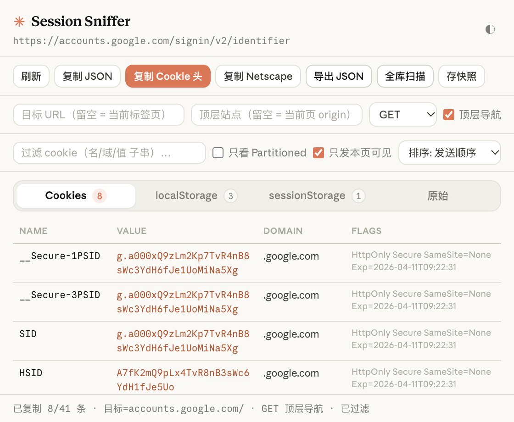
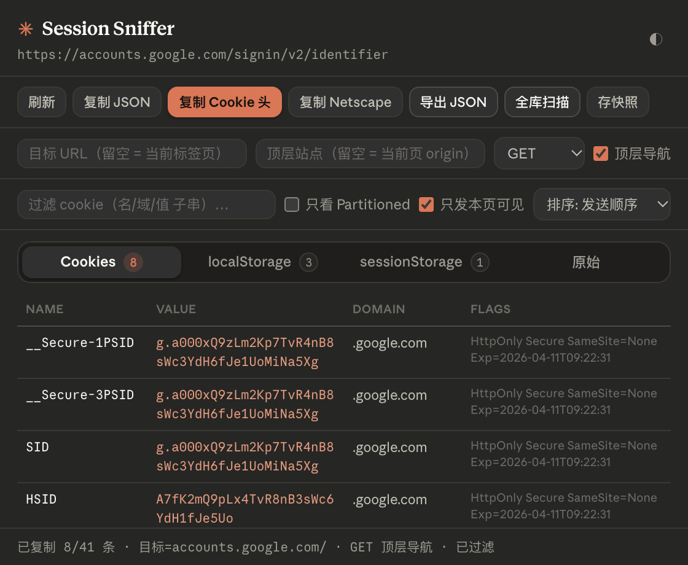

# Session Sniffer · 页面会话数据查看与导出

查看当前标签页的 Cookies（含 HttpOnly）、localStorage、sessionStorage 和 document.cookie，支持复制 Cookie 头、导出 JSON，以及枚举浏览器 API 可访问的 Cookie。

当前版本 **1.0.0**，采用 Manifest V3，可在 Chrome、Edge 等支持所需扩展 API 的浏览器中加载。本目录无需安装依赖或执行构建。




## 安装与采集

1. Chrome 打开 `chrome://extensions/`；Edge 打开 `edge://extensions/`。
2. 开启**开发者模式**，点击**加载已解压的扩展程序**。
3. 选择当前 `Session-Sniffer/` 目录，即包含 [manifest.json](manifest.json) 的目录。
4. 打开目标网站，点击工具栏中的扩展图标，等待采集完成。
5. 页面登录态或存储变化后，点击弹窗中的**刷新**重新采集。

更新文件后，在扩展管理页重新加载扩展，重新打开弹窗；页面侧脚本需要刷新网页后更新。

## 查看采集数据

| 页签 | 内容 | 范围 |
| --- | --- | --- |
| Cookies | 名称、值、域名、路径及 HttpOnly、Secure、SameSite、分区等标记 | 初次采集使用 chrome.cookies.getAll({ url }) 返回的 Cookie |
| localStorage | 存储键值 | 当前标签页顶层文档 |
| sessionStorage | 存储键值 | 当前标签页顶层文档 |
| 原始 | JSON 数据 | 当前页采集快照，不随表格筛选或全库扫描变化 |

Cookie 通过浏览器扩展 API 读取，可以包含 HttpOnly 数据；document.cookie 只包含页面脚本可读取的部分。Web Storage 使用注入到顶层页面主世界的函数读取，不采集 iframe 内部数据。

### 表格筛选与全库扫描

- 过滤框按 Cookie 的名称、域名、路径和值进行不区分大小写的子串匹配。
- **只看 Partitioned**仅在表格中保留带 partitionKey 的条目。
- **全库扫描**调用 chrome.cookies.getAll({})，将 Cookie 表格的数据源切换为该调用返回的集合；localStorage、sessionStorage 和原始快照保持当前页采集结果。
- 点击**刷新**会退出全库视图并重新采集当前页。

「全库」表示本次 API 调用不按当前 URL 限定，不代表已显式遍历所有独立 Cookie store 或所有分区上下文。

| 排序选项 | 当前规则 |
| --- | --- |
| 发送顺序 | path 较长的在前，长度相同时 domain 较长的在前 |
| 域名+名称 | 按 domain、name 字典序排列 |
| 原始 | 保留当前数据源已有顺序；采集和全库扫描阶段已做过域名相关排序 |

「发送顺序」是当前实现的近似规则，不保证与浏览器请求中的实际 Cookie 顺序一致。

## 复制与导出

不同按钮使用的数据范围不同，**表格中看到的条目不一定等于导出的条目**。

| 操作 | 输出 | 当前使用的数据 |
| --- | --- | --- |
| 复制 JSON | 当前页快照 JSON | 当前页采集结果，不受表格筛选或全库扫描影响 |
| 复制 Cookie 头 | name=value; name2=value2 | 全库扫描结果（如有），否则为当前页 Cookie；可按发送条件过滤，但不使用文本搜索和 Partitioned 表格筛选 |
| 复制 Netscape | 制表符分隔的 cookie.txt 内容 | 当前页 Cookie，不使用全库扫描结果或表格筛选 |
| 导出 JSON | session_域名_时间戳.json，弹出保存对话框 | 与复制 JSON 相同的当前页快照 |
| 存快照 | 写入扩展本地存储 | 当前页快照；覆盖上一次保存内容 |

JSON 包含 capturedAt、url、origin、cookies、localStorage、sessionStorage 和 documentCookie。当前界面没有载入历史快照、快照列表、导入或恢复登录态的按钮；需要保留多次采集结果时，请分别导出 JSON。

Netscape 格式适用于支持 cookie.txt 的工具，不是 Puppeteer 可直接使用的 JSON，也不能完整保留 SameSite、Partition key 等扩展字段。需要 Puppeteer 格式时，可使用下文的命令行转换工具。

## 按目标请求条件复制 Cookie 头

1. 先采集当前页；目标接口位于其他路径或子域名时，可先点击**全库扫描**扩大候选范围。
2. 填写**目标 URL**；留空时使用当前采集页面的 URL。
3. 填写**顶层站点**；留空时使用当前页 origin。
4. 选择 HTTP 方法，并按实际场景设置**顶层导航**。
5. 保持**只发本页可见**勾选，点击**复制 Cookie 头**。

当前过滤函数检查 HTTPS/Secure、过期时间、域名、路径、SameSite、分区键以及 __Host- / __Secure- 前缀约束。取消「只发本页可见」后，复制头会使用当前候选集合中的全部 Cookie。

**这是一份根据输入条件计算的候选头，不是浏览器真实请求的抓包结果。** 扩展没有监听网络请求；目标 URL 输入只参与过滤，不会自动发起请求或重新采集该 URL 的 Cookie。当前「只发本页可见」也只控制复制 Cookie 头，未应用于表格、JSON 或 Netscape 输出。

### 过滤的当前限制

- 域名判断未使用 Cookie 的 hostOnly 字段，可能把只属于某个主机的 Cookie 纳入子域名请求。
- SameSite 分支直接比较 None / Lax / Strict，未统一浏览器返回值的命名和大小写，跨站过滤可能不准确。
- 同站判断使用内置的有限后缀表，并未完整处理协议差异及浏览器的其他发送策略。
- 无法根据创建时间复现未显式声明 SameSite 的新 Cookie 的临时发送例外；排序也没有使用创建时间。
- 分区键只按顶层可注册域近似比较，无法覆盖全部分区及第三方 Cookie 策略。
- 非法目标 URL 会使过滤函数返回未过滤集合，请使用有效的完整 HTTP(S) URL。

需要确认某次请求实际携带哪些 Cookie 时，应以浏览器 Network 面板中的请求为准。

## 本地命令行工具

目录中保留两个独立脚本，需要本机有 Node.js。以下命令在 `Session-Sniffer/` 中运行，dump.json、before.json 和 after.json 均指从弹窗导出的实际 JSON 文件。

### 查找候选登录 Cookie 与转换格式

[auth-detect.mjs](auth-detect.mjs) 支持：

```bash
node auth-detect.mjs list dump.json
node auth-detect.mjs curl dump.json
node auth-detect.mjs header dump.json
node auth-detect.mjs puppeteer dump.json
node auth-detect.mjs diff before.json after.json
```

- list 按名称、HttpOnly、Secure、值长度和形态等特征列出候选。
- curl 和 header 优先使用评分达到阈值的候选；没有候选时使用输入文件中的全部 Cookie，不执行弹窗里的目标发送过滤。
- puppeteer 将输入 Cookie 转为对应的 JSON 字段。
- diff 按 domain、path、name 对比，找出新增或值发生变化的条目，不比较所有属性和分区上下文。

登录前后差异和评分只是定位线索，不能单凭某项变化确认其就是登录凭据。脚本生成命令或格式化数据，本身不发起登录或请求。

### 查看打包 Cookie 的字节结构

[decode-cookie.js](decode-cookie.js) 可将冒号分隔的打包值按 Base64URL 解码，并尝试显示 protobuf wire-format 字段：

```bash
node decode-cookie.js --from-json dump.json COMPASS
```

将 COMPASS 换成输入文件中实际存在的 Cookie 名称。该工具不持有站点的 protobuf schema，也不保证能解释所有字段含义或所有 Cookie 格式。

## 常见问题

**localStorage 或 sessionStorage 为空。** 页面可能本来未写入数据，也可能受到注入权限或页面环境限制。当前只读取顶层文档，不读取 IndexedDB、Cache Storage 或 iframe 存储。

**全库扫描后 JSON 里的 Cookie 数量没增加。** 全库结果仅供表格和复制 Cookie 头使用；JSON、Netscape 及存快照仍使用当前页采集数据。

**改变目标 URL 或勾选「只发本页可见」后，表格数量不变。** 当前发送过滤仅应用于复制 Cookie 头，表格由搜索框和 Partitioned 条件筛选。

**显示采集完成，但数据似乎不完整。** 当前页只按 URL 获取 Cookie，受权限及 Cookie store 范围影响；受限页面也可能无法注入。完成状态只表示采集流程结束，不保证每类数据都成功读取。

浏览器内部页、扩展商店及其他禁止注入的页面不能正常读取页面存储。当前没有 Cookie 编辑、导入或自动恢复登录态的功能。

## 主题与补充文档

顶部主题按钮依次切换**跟随系统 → 浅色 → 深色**，选择保存在扩展本地存储。界面使用 fonts/ 中的本地字体。

[preview.html](preview.html) 是可直接打开的静态界面预览，使用示例数据，不进行真实采集；支持 theme=light / dark 和 tab=cookies / local / session / raw 查询参数。

| 文档 | 内容 |
| --- | --- |
| [COOKIE-BASICS.md](COOKIE-BASICS.md) | Cookie 属性、用途及与其他存储的比较 |
| [COOKIE-VS-SESSION.md](COOKIE-VS-SESSION.md) | Cookie 与服务端会话的关系 |
| [AUTH-COOKIE.md](AUTH-COOKIE.md) | 通过登录前后快照差异辅助定位凭据 |
| [THEME.md](THEME.md) | 字体、色板、布局及图标说明 |

## 权限与数据

| 权限 | 用途 |
| --- | --- |
| cookies / `<all_urls>` | 读取授权范围内的 Cookie，支持不按当前 URL 限定的枚举 |
| tabs / activeTab | 获取当前标签页及其 URL |
| scripting | 注入函数读取顶层页面的 Web Storage 与 document.cookie |
| storage | 保存最近一次快照和主题偏好 |
| downloads | 将 JSON 保存为本地文件 |

当前扩展及命令行脚本没有远程上传或主动网络请求。复制结果进入系统剪贴板，导出数据写入所选文件，保存快照写入 chrome.storage.local。数据中可能包含当前会话凭据，应仅在自己拥有或获授权的账号和环境中使用。

## 目录结构

```text
Session-Sniffer/
├── manifest.json
├── background.js          Cookie 读取、主世界存储采集和本地快照保存
├── content.js             PING_STORAGE 消息通道，当前弹窗采集流程未调用
├── popup.html / popup.css / popup.js
├── auth-detect.mjs         Cookie 评分、差分和格式转换
├── decode-cookie.js        打包值的字节结构分析
├── preview.html           静态界面预览
├── preview-light.png / preview-dark.png
├── fonts/                 本地字体
├── icons/                 扩展图标及文档配图
├── COOKIE-BASICS.md / COOKIE-VS-SESSION.md / AUTH-COOKIE.md / THEME.md
└── README.md
```
