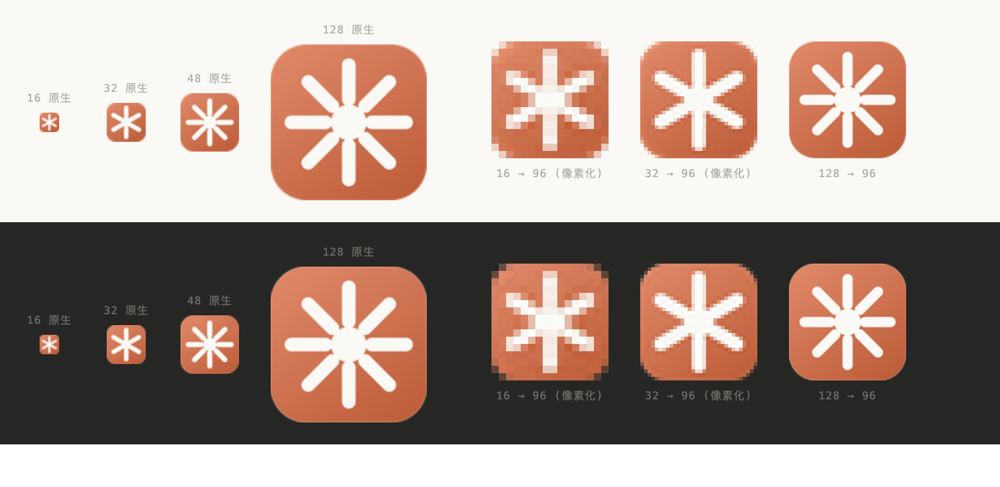

# Theme & Typography Spec (Claude Visual System)

The popup UI of this extension is rebuilt around **Claude's visual language**: cream background, clay-orange accent, Anthropic's own type families, hairline strokes, restrained shadows. This document records how the colors and type were sampled and how they are implemented, so later changes stay consistent.

> Reference sample: `~/Downloads/Claude` (an offline archive of Claude Web). Fonts and color values were measured directly out of its `css/*.css` and `assets/*.woff2`, not tuned by eye.

---

## 1. Typography

### 1.1 Three families

| Family | File | Use | Weight |
|---|---|---|---|
| **Anthropic Sans** | `fonts/anthropic-sans.woff2` (+ italic) | UI body text, buttons, labels, table headers | Variable **300–800** |
| **Anthropic Serif** | `fonts/anthropic-serif.woff2` | Brand title (`h1`) | Variable **300–800** |
| **Anthropic Mono** | `fonts/anthropic-mono.woff2` | cookie names/values, URLs, status bar, JSON | 400 |

All three are **variable fonts** (`wght` axis 300–800); one file covers every weight — measured advance widths change linearly with weight, which proves the axis is live:

```
Sans 400 = 505.2px   Sans 600 = 519.6px   Sans 800 = 540.3px   (same string measured at 40px)
```

### 1.2 Fallback stacks

Chinese is not covered by the Anthropic font set, so it falls back to system fonts. The stacks are ordered "Latin brand font first → system UI next → CJK last":

```css
--font-ui:    "Anthropic Sans", ui-sans-serif, system-ui, -apple-system,
              "Segoe UI", Roboto, "PingFang SC", "Hiragino Sans GB",
              "Microsoft YaHei", sans-serif;

--font-serif: "Anthropic Serif", Georgia, "Songti SC", "PingFang SC",
              "Noto Serif SC", serif;

--font-mono:  "Anthropic Mono", ui-monospace, SFMono-Regular, Menlo, Consolas,
              "PingFang SC", monospace;
```

### 1.3 Usage conventions

| Element | Family | Size | Notes |
|---|---|---|---|
| `h1` brand name | Serif | 15px / 600 | Preceded by a `✳` star, clay orange |
| Button / label / checkbox text | Sans | 11px | `font-weight: 500` |
| Input placeholder | Sans | 11.5px | Actual input text uses Mono |
| Table header `th` | Sans | 9.5px / 600 | Uppercase + `.03em` tracking |
| cookie name / value | Mono | 10.5px | `font-variant-numeric: tabular-nums` |
| domain | Mono | 10px | Muted color |
| flags | Sans | 9.5px | Faintest color, line-height 1.45 |
| Status bar / URL | Mono | 10–10.5px | — |

> **Why cookie names/values are monospaced**: these are machine-generated, unreadable strings; a monospace face lines up names like `__Secure-1PSID` and `g.a000xQ9z…` so they scan quickly, and makes the difference between similar prefixes obvious. **Why the brand name is serif**: it is Claude's identifying trait — the one thing that separates "a tool UI" from "a dark theme someone threw on".

---

## 2. Palette

Taken from the HSL triples in Claude's CSS and converted to hex as-is. **Light is Claude's signature cream base, dark is Claude's warm dark-grey base** — note that neither is a neutral grey, both carry a little warmth (hue 30–60).

### 2.1 Light (default)

| Token | hex | HSL | Where it is used |
|---|---|---|---|
| `--bg-page` | `#FAF9F5` | 48 33% 97% | Page background, table header background |
| `--bg-surface` | `#FFFFFF` | 0 0% 100% | Buttons, inputs, active tab |
| `--bg-sunken` | `#F0EFE9` | 45 12% 93% | Segmented control container, `pre` background |
| `--bg-inset` | `#F6F5F0` | — | Row hover |
| `--fg-strong` | `#121212` | 0 0% 7% | Primary text, cookie names |
| `--fg` | `#373734` | 60 3% 21% | Body text, button text |
| `--fg-muted` | `#7B7974` | 43 3% 47% | Secondary information, domain |
| `--fg-faint` | `#A9A79E` | — | Table headers, flags, placeholders |
| `--line` | `#E2E1DA` | 53 12% 87% | Regular strokes |
| `--line-strong` | `#D2D1C6` | 55 11% 80% | Hover strokes, header bottom edge |
| `--accent` | `#D97757` | **14.8 63% 60%** | Claude clay orange: primary buttons, star |
| `--accent-hover` | `#C4643F` | — | Primary button hover |
| `--value` | `#AD5733` | — | cookie values only (darkened to keep contrast) |

### 2.2 Dark

| Token | hex | HSL |
|---|---|---|
| `--bg-page` | `#262624` | 60 2.7% 14.5% |
| `--bg-surface` | `#303030` | 0 0% 19% |
| `--bg-sunken` | `#1F1E1D` | 30 3.3% 11.8% |
| `--fg-strong` | `#FAF9F5` | 48 33% 97% |
| `--fg` | `#C2C0B6` | 50 9% 74% |
| `--fg-muted` | `#9C9A92` | 48 5% 59% |
| `--fg-faint` | `#6E6C68` | — |
| `--line` | `#3A3936` | 60 2% 17% |
| `--line-strong` | `#4C4B47` | — |
| `--value` | `#E29B7F` | — |

### 2.3 About `--value`

The raw `#D97757` only reaches **≈2.9:1** contrast on the cream background, which fails for 10.5px small text. So `--value` is split out as its own token: darkened to `#AD5733` (≈4.7:1) in light, lightened to `#E29B7F` (≈6.5:1) in dark. **Keeping the accent color and the readable text color separate** is the only place this theme departs from the original site's palette.

---

## 3. Three-state theme

```
auto (default) ── follows the system prefers-color-scheme
  ├─ light  force light (even when the system is dark)
  └─ dark   force dark (even when the system is light)
```

The implementation is three CSS layers plus one attribute:

```css
:root, :root[data-theme="light"] { /* light tokens */ }

@media (prefers-color-scheme: dark) {
  :root:not([data-theme="light"]) { /* dark tokens */ }   /* auto and the system is dark */
}

:root[data-theme="dark"] { /* dark tokens */ }            /* manually locked dark, highest priority */
```

- In `auto` the `data-theme` attribute is **removed** → the media query takes over
- A manual lock writes `data-theme="light|dark"` → the media query is blocked by `:not([data-theme="light"])`
- The choice is stored in `chrome.storage.local` under the `sniffer.theme` key and applies the next time the popup opens

Interaction entry point: the round button at the top right of the header; clicking cycles `auto → light → dark → auto`, the icon is `◐ / ☀ / ☾`, and `title` states the current mode.

`color-scheme: light dark` is also declared (once on `:root` and once in `<meta name="color-scheme">`) so native controls — select arrows, checkboxes, scrollbars — follow the theme automatically, and a white dropdown never pops out of a dark surface.

---

## 4. Layout

Fixed at **560 × 460** (Chrome caps popups at 800 wide; this takes the compact size).

```
┌──────────────────────────────────────────┐  header     ~48px
│ ✳ Session Sniffer                    ◐  │
│ https://accounts.google.com/…            │
├──────────────────────────────────────────┤  toolbar    ~38px (7 buttons in one row)
├──────────────────────────────────────────┤  ctx bar    ~38px
├──────────────────────────────────────────┤  filter bar ~38px
├──────────────────────────────────────────┤  tabs       ~36px (segmented control)
├──────────────────────────────────────────┤
│ Table (scrollable, sticky header)        │  main       rest
├──────────────────────────────────────────┤
│ Status bar                               │  footer     ~28px
└──────────────────────────────────────────┘
```

### Table column widths

`table-layout: fixed`, four columns:

| Column | Width | Content |
|---|---|---|
| name | 106px | cookie name, Mono |
| value | auto (≈160px) | cookie value, Mono + `--value` |
| domain | 96px | domain; **the path follows it when it is not `/`** (`.google.com /accounts`) |
| flags | 170px | HttpOnly / Secure / SameSite / Partitioned / expiry |

> **Why the path column was cut**: 99% of cookie paths are `/`, so a dedicated column wastes 36px of horizontal space — and horizontal space is exactly what lets value and flags each take 2 lines and show one more row per screen. Paths that are not `/` are merged into the domain cell, so no information is lost.

### Overflow strategy

- name / value / domain: `word-break: break-all` + `overflow-wrap: anywhere` (unreadable strings have to break hard)
- flags: `word-break: normal` + `overflow-wrap: break-word` (must break on spaces, otherwise `SameSite=None` gets split)
- Expiry is formatted as `Exp=MM-DD HH:MM`, 8 characters shorter than full ISO, which fits exactly into 2 lines

---

## 5. Interaction

| State | Behavior |
|---|---|
| `:focus-visible` | `border-color: --accent` + `box-shadow: 0 0 0 3px --accent-soft` (a 3px glow, not an outline) |
| Button hover | Background → `--bg-inset`, stroke → `--line-strong`, text → `--fg-strong` |
| Button active | `translateY(.5px)`, simulating a press |
| Table row hover | Background → `--bg-inset` |
| Transitions | `.12s ease` (`.08s` for movement) |
| `::selection` | `--sel` (clay orange at 22% opacity) |
| `prefers-reduced-motion` | All transitions / animations off |

Primary and secondary buttons: `#copyheader` (copy Cookie header) is the solid clay-orange primary action; `#scanall` / `#export` use a strong stroke for secondary emphasis; the rest are ordinary stroked buttons. **Only one solid color block per screen** — that is where Claude's restraint comes from.

---

## 6. Preview and debugging

`preview.html` is a design mock that runs outside the Chrome extension environment, seeded with fake data. Open it directly in a browser:

```
preview.html                      follow the system
preview.html?theme=light          force light
preview.html?theme=dark           force dark
preview.html?tab=local            show the localStorage panel
preview.html?tab=raw              show the raw JSON panel
```

Screenshots (for design regression comparison):

```bash
"/Applications/Google Chrome.app/Contents/MacOS/Google Chrome" \
  --headless --disable-gpu --hide-scrollbars \
  --force-device-scale-factor=2 --window-size=560,460 \
  --virtual-time-budget=3000 --screenshot=/tmp/shot.png \
  "file://$PWD/preview.html?theme=dark"
```

---

## 7. Re-theming touches tokens only

**Every color, font, and radius goes through CSS variables**; no hardcoded color value is scattered through the rules. To reskin:

1. Change the tokens in `:root` → light
2. Change `@media (prefers-color-scheme: dark)` and `:root[data-theme="dark"]` → dark (both must stay in sync, otherwise manually locked dark and automatic dark disagree)
3. Swap `--font-ui / --font-serif / --font-mono`, or replace `fonts/*.woff2` and update the `src` in `@font-face`


---

## 8. Font provenance and redistribution

The four `.woff2` files under `fonts/` are **Anthropic's own brand fonts** (Anthropic Sans / Serif / Mono, variable, `wght` 300–800) extracted from the Claude Web archive. Local personal use, internal tooling, and design alignment are fine; if this extension is ever packaged and distributed to a store, the font licensing has to be confirmed separately — at that point point `@font-face` at substitute fonts (e.g. Inter / Source Serif / JetBrains Mono) and no other token needs to change.

---

## 9. Differences from the original Claude site

Only the visual language is borrowed, no components are copied:

| Original site | This extension |
|---|---|
| Sidebar + conversation stream + composer | Single-page popup, fixed 560×460 |
| Generous whitespace, 14px body text | High-density table, 11px body text, 9.5px headers |
| Multi-level card shadows | Only two shadow levels (`--shadow-1` / `--shadow-2`) |
| Clay orange as accent/link color | Clay orange only on the "copy Cookie header" button |
| Full icon system | Only the star mark + the three glyphs `◐/☀/☾` |

---

## 10. Icons

A clay-orange gradient squircle base with a cream radiating star. The star is Claude's brand mark; the same shape also precedes the popup header `h1` (`icons/mark.svg`, clay orange on transparent).



### 10.1 Geometry

A single parameter table — change one value and everything updates:

| Parameter | Full version (48 / 128) | Simplified version (16 / 32) |
|---|---|---|
| Canvas | 128 | 32 |
| Corner radius | 29 (22.7%) | 7.2 (22.5%) |
| Number of rays | **8** | **6** |
| Ray inner/outer radius | 19 → 47 | 5.0 → 12.0 |
| Ray stroke width | 11.2 | 3.7 |
| Center disc radius | 14 | 3.6 |
| Start angle | −90° (a ray points straight up) | −90° |

**Why small sizes drop to 6 rays**: at 16px the gaps between 8 rays are less than one pixel, and anti-aliasing blurs them into a blob of white dots. Only 6 rays with a thicker stroke (11.6% vs 8.75% of the canvas) keeps the "radiating" reading at 16px. This is not a scale-down, it is a re-balance — every professional icon set does the same.

### 10.2 Background

The `linearGradient` runs from `#DE8767` (top left) to `#BE5E3A` (bottom right) at 45° rather than vertically — a vertical gradient reads as two blocks of color at small sizes. A 1.5px inner stroke of `#FFFFFF 18%` is layered on top to simulate the single line of reflected light along the icon edge.

**Why a clay-orange base instead of cream**: the browser toolbar is light grey in the light theme and dark grey in the dark theme. A cream icon dissolves into a light toolbar, whereas clay orange holds up against both backgrounds and carries the strongest brand recognition.

### 10.3 How the icons were generated

The existing icons were rendered from SVG by Chrome at 8× size, then downscaled to the target sizes with Pillow LANCZOS. The directory keeps the SVG source files, the PNGs at each size, and the preview image; the generation script has been removed.

**Why not have Chrome render 16px directly**: headless Chrome imposes a minimum window size, so requesting 16×16 or 48×48 actually renders larger and the screenshot is cropped to a corner of the top left (the first version failed exactly this way). So everything is rendered at 8× first (16→128, 128→1024) and then downscaled.

### 10.4 Files

| File | Size | Used for |
|---|---|---|
| `icons/icon.svg` | Vector, 128 canvas | Source file (full 8-ray version) |
| `icons/icon-small.svg` | Vector, 32 canvas | Source file (simplified 6-ray version) |
| `icons/mark.svg` | Vector, transparent background | The star before the popup header `h1` |
| `icons/icon16.png` | 16×16 | Toolbar, small icon on the extensions page |
| `icons/icon32.png` | 32×32 | Toolbar on Windows high-DPI displays |
| `icons/icon48.png` | 48×48 | Extensions page |
| `icons/icon128.png` | 128×128 | Store listing, install dialog |
| `icons/preview.png` | — | The size comparison image in this document |

The four PNGs are registered in two places in `manifest.json`: `icons` and `action.default_icon`. `icons` decides what the extensions page and store listing show, `default_icon` decides the toolbar button — miss the latter and the toolbar shows a grey block.
